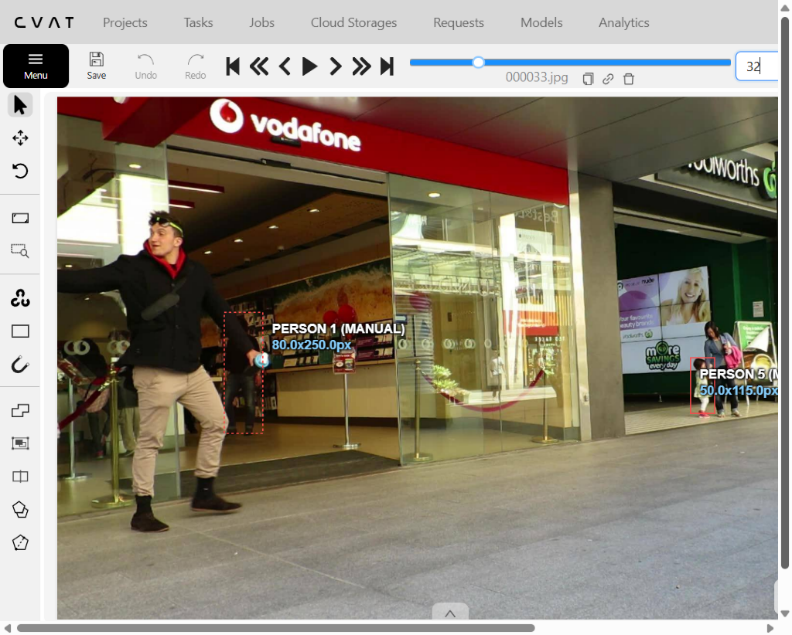

# Báo cáo cá nhân — 2A202603165_PhanThanhHao

Đoạn video: MOT17-09, 150 frame (frame 1–150), nguồn MOTChallenge, giấy phép CC BY-NC-SA 3.0.

## 0. Thông tin học viên

- Họ tên: Phan Thanh Hảo
- MSSV: 2A202603165
- Mã đề (A/B/C): A
- Email:  26ai.haopt@vinuni.edu.vn
- Link repository: https://github.com/phanthanhhao0612/K5-L2A-PhanThanhHao_2A202603165-MOTTracking
- Giờ bắt đầu: 16:45
- Giờ kết thúc: 18:30

## 1. Xem trước đoạn video (CP0)

Ghi **trước khi vẽ**, mỗi người một dòng.

| Mã | Frame xuất hiện | Frame cuối thấy được | Rẽ / dừng / đổi tốc độ ở frame | Bị che ở frame | Ghi chú |
|---|---|---|---|---|---|
| P1 | 0 | 149 | Chuyển động chậm đều bên trong shop Vodafone | 24–57 (mất hẳn 31–48) | Người đàn ông áo len đen trong shop Vodafone (bị P2 che) |
| P2 | 61 | 149 | Bước đi đều từ trái sang phải | 61–72 (bị che nhẹ lúc mới vào) | Chàng trai áo khoác đen, quần kaki (bắt đầu vào từ frame 61) |
| P3 | 0 | 149 | Bước đi đều ở vỉa hè | Không | Người mặc áo sơ mi xanh kẻ sọc |
| P4 | 0 | 149 | Đi thẳng dọc phố bên phải | 0–63 (bị che một phần) | Người mặc áo xanh lam ở lề phải |
| P5 | 0 | 106 | Đi qua đường, ra khỏi biên ở 106 | 0–8 (bị che nhẹ) | Bé gái mặc áo trắng (outside từ frame 107–149) |

## 2. Keyframe và thời gian (CP1, CP4)

Số keyframe lấy từ kết quả `src/check_submission.py`.

| Mã | Số keyframe | Keyframe ở frame | Số frame có mặt | Keyframe / 100 frame | Thời gian (phút) | Chỗ khó |
|---|---|---|---|---|---|---|
| P1 | 14 | 0, 12, 24, 30, 49, 55, 67, 79, 91, 103, 115, 127, 139, 149 | 132 | 10.6 | 15 | Bị che khuất hoàn toàn qua lớp kính cửa hàng |
| P2 | 9 | 61, 73, 84, 95, 106, 117, 128, 139, 149 | 89 | 10.1 | 10 | Xuất hiện từ frame 61, di chuyển từ trái sang phải |
| P3 | 14 | 0, 12, 24, 36, 48, 60, 72, 84, 96, 108, 120, 132, 144, 149 | 150 | 9.3 | 10 | Đi thẳng đều dọc vỉa hè |
| P4 | 14 | 0, 12, 24, 36, 48, 60, 72, 84, 96, 108, 120, 132, 144, 149 | 150 | 9.3 | 10 | Đi dọc lề phải, bị che một phần bởi người đi đường |
| P5 | 10 | 0, 12, 24, 36, 48, 60, 72, 84, 96, 106 | 107 | 9.3 | 8 | Ra khỏi khung hình từ frame 107 |
| **Tổng** | 61 | - | 628 | 9.7 | 53 | - |

Keyframe / 100 frame của cả bài = tổng keyframe ÷ tổng số frame có mặt × 100 = 61 ÷ 628 × 100 = 9.7 keyframe / 100 frame.

Bạn đặt keyframe nhiều nhất ở người nào? Vì sao (người đó rẽ, dừng, lại gần camera hay bị che)?

Đặt keyframe nhiều nhất ở **P1 (14 keyframe)**. Lý do: P1 di chuyển phía sau lớp kính cửa hàng Vodafone và bị che khuất (bắt đầu che một phần từ frame 24, che hoàn toàn từ frame 31 đến 48, hiện lại từ frame 49 và rõ dần đến frame 58). Cần cắm keyframe dày hơn quanh điểm bắt đầu bị che (frame 24, 30), khi vừa ra khỏi vùng che (frame 49, 55) để tránh việc nội suy tuyến tính kéo lệch box sang người che hoặc bị trôi box do phản chiếu ánh sáng trên bề mặt kính.

## 3. Đoạn bị che (CP2)

Người bị che: `P1`

| Mốc | Frame |
|---|---:|
| Bắt đầu bị che một phần (bật `occluded`) | 24 |
| Mất hẳn (bật `outside`) | 31 |
| Hiện lại (tắt `outside`) | 49 |
| Thấy rõ trở lại (tắt `occluded`) | 58 |

- Thời gian khuất hẳn: 18 frame = 0.60 giây (tại tốc độ 30 fps).
- Quyết định: **Giữ cùng ID (Track ID 1)**.
- Lý do (trả lời 3 câu: khuất bao lâu so với 60 frame, ngoại hình có khớp, chỗ hiện lại có đúng hướng và tốc độ):
  1. **Thời gian khuất:** P1 biến mất hoàn toàn trong 18 frame (~0.60 giây), ngắn hơn rất nhiều so với ngưỡng 60 frame (2 giây) quy ước của bài lab.
  2. **Ngoại hình:** Khi tái xuất hiện ở frame 49, người đàn ông mang đặc điểm hoàn toàn trùng khớp: áo len đen dài tay, dáng vóc trung niên, không có sự thay đổi trang phục hay phụ kiện.
  3. **Vị trí và hướng di chuyển:** Vị trí tái xuất hiện tiếp nối mượt mà theo đúng quỹ đạo bước đi về phía bên phải cửa hàng với vận tốc đều, không có hiện tượng dịch chuyển tọa độ đột ngột.

Ảnh chụp màn hình:





## 4. Tự review ID (CP3)

Lượt 1 theo người (đi ngược từ frame 149 về 0 trên CVAT), lượt 2 theo cảnh (nhảy 10 frame).

Loại lỗi dùng đúng một trong 7 mã: `id_switch`, `fragmentation`, `lost`, `merge`, `false_track`, `drift`, `flag`.

| Frame | Mã người | Loại lỗi | Mô tả một câu | Phát hiện ở lượt | Đã sửa? |
|---:|---|---|---|---|---|
| 30 | P1 | drift | Box nội suy bị trôi nhẹ sang phải trước khi P1 bị che hoàn toàn | Lượt 1 (theo người) | Đã sửa (thêm keyframe tại frame 30) |
| 49 | P1 | fragmentation | Khi hiện lại suýt tạo nhầm track mới do thói quen bấm phím N | Lượt 1 (theo người) | Đã sửa (chọn lại Track 1 và tắt cờ outside) |
| 107 | P5 | lost | P5 đã đi khỏi khung hình ở frame 106 nhưng chưa bật outside ở frame 107 | Lượt 2 (theo cảnh) | Đã sửa (bật cờ outside từ frame 107) |

Tổng hợp số lỗi theo loại:

| `id_switch` | `fragmentation` | `lost` | `merge` | `false_track` | `drift` | `flag` |
|---:|---:|---:|---:|---:|---:|---:|
| 0 | 1 | 1 | 0 | 0 | 1 | 0 |

Lỗi nào chỉ lượt 2 (theo cảnh) mới thấy, lượt 1 (theo người) không thấy? Vì sao?

Lỗi `lost` của P5 ở rìa khung hình (frame 107) và các lỗi va chạm giữa các box dễ thấy ở Lượt 2 (theo cảnh) hơn. Lý do: Khi kiểm tra Lượt 1 theo từng người, mắt ta tập trung cao độ vào hành trình di chuyển của riêng đối tượng đó trong vùng trung tâm; chỉ khi lùi lại quan sát toàn cảnh (Lượt 2) với toàn bộ các đối tượng cùng lúc, ta mới nhận ra đối tượng đã vượt qua ranh giới màn hình hoặc có box bị sót/trôi ở mép khung ảnh.

## 5. File xuất và kết quả tự kiểm (CP4)

| Kiểm tra | Kết quả |
|---|---|
| Tên file MOT 1.1 | `PhanThanhHao_mot.zip` |
| Tên file CVAT for video 1.1 | `PhanThanhHao_cvat_video.zip` |
| Số track ID khác nhau trong `gt/gt.txt` (phải là 5) | 5 |
| Frame `outside` không có dòng trong `gt.txt` (đúng / sai) | Đúng (các frame 31–48 của Track 1 và 107–149 của Track 5 không có dòng) |
| Job đã completed trên CVAT máy cá nhân | Hoàn thành (completed) |

Dán phần tóm tắt in ra từ `src/check_submission.py`:

```text
Số frame in theo CVAT (bắt đầu từ 0). Trong gt.txt, frame_id = frame CVAT + 1.

=== File MOT 1.1: PhanThanhHao_mot.zip ===
  Số track ID: 5   |   Tổng số box: 628
  [OK]        Đúng 5 track ID.

  Track | Frame có mặt | Số frame | Đoạn vắng (outside)
      1 |   0–149      |      132 | 31–48
      2 |  61–149      |       89 | -
      3 |   0–149      |      150 | -
      4 |   0–149      |      150 | -
      5 |   0–106      |      107 | -

=== File CVAT for video 1.1: PhanThanhHao_cvat_video.zip ===

  Track | Nhãn   | Frame thấy | Keyframe | KF/100 frame | Frame occluded | Lần bật outside
      0 | person |        132 |       14 |         10.6 |             16 |               1
              Track 0: keyframe ở frame [0, 12, 24, 30, 49, 55, 67, 79, 91, 103, 115, 127, 139, 149]
      1 | person |         89 |        9 |         10.1 |             13 |               0
              Track 1: keyframe ở frame [61, 73, 84, 95, 106, 117, 128, 139, 149]
      2 | person |        150 |       14 |          9.3 |              0 |               0
              Track 2: keyframe ở frame [0, 12, 24, 36, 48, 60, 72, 84, 96, 108, 120, 132, 144, 149]
      3 | person |        150 |       14 |          9.3 |             63 |               0
              Track 3: keyframe ở frame [0, 12, 24, 36, 48, 60, 72, 84, 96, 108, 120, 132, 144, 149]
      4 | person |        107 |       10 |          9.3 |             84 |               1
              Track 4: keyframe ở frame [0, 12, 24, 36, 48, 60, 72, 84, 96, 106]

  Tổng: 61 keyframe / 628 frame có mặt = 9.7 keyframe / 100 frame
  [OK]        Đọc được 5 track từ annotations.xml.

=== Tóm tắt ===
  Lỗi: 0   |   Cảnh báo: 0
  Đạt. Dán phần tóm tắt này vào báo cáo mục 5.
```

## 6. Ba câu kết

1. **Nếu được gán lại, bạn sẽ đặt keyframe khác ở đâu? Vì sao?**  
   Tôi sẽ đặt thêm 1 keyframe ở khoảng frame 28 ngay sát trước thời điểm P1 chuẩn bị bị che khuất hoàn toàn. Do P1 di chuyển phía sau lớp kính phản chiếu, việc cắm thêm 1 điểm neo chính xác ở đây sẽ giúp đường bao amodal giữ vị trí ổn định hơn, tránh tình trạng box nội suy bị lệch nhẹ theo bóng phản chiếu trước khi bật cờ `outside`.

2. **Có chỗ nào bạn không chắc "cùng ID hay ID mới"? Bạn đã quyết định và ghi chú thế nào?**  
   Đó là ở thời điểm P1 tái xuất hiện sau khi bị che khuất (frame 49). Do P1 bị che hoàn toàn 100% trong 18 frame (0.60s), mắt thường có thể hoài nghi liệu người bước ra có phải là P1 hay một khách hàng khác trong quán. Tôi đã đối chiếu quy tắc 3 bước của bài lab: thời gian vắng mặt chỉ 0.60 giây (< 2 giây), trang phục áo len đen hoàn toàn nhất quán, và vị trí xuất hiện tiếp diễn tự nhiên theo hướng đi sang phải. Do đó, tôi tự tin quyết định giữ nguyên Track ID 1.

3. **Một lỗi ID trong job của bạn (nếu không còn sót, chọn lỗi đã sửa) có thể làm xe tự lái dự đoán sai chuyển động của người đó như thế nào? Lỗi đó ảnh hưởng MOTA hay IDF1 nhiều hơn?**  
   Nếu để xảy ra lỗi `id_switch` giữa P1 (đang đi chậm trong cửa hàng) và P2 (đang đi nhanh trên vỉa hè), mô-đun ước lượng vận tốc của xe tự lái sẽ tính toán một bước nhảy tọa độ bất thường: đối tượng dịch chuyển hơn 1.5 mét chỉ trong 1/30 giây, tương đương vận tốc giả tạo lên tới 162 km/h. Hệ thống lập kế hoạch quỹ đạo (trajectory planning) sẽ đánh giá đây là vật thể lao ra đường với tốc độ cực lớn và kích hoạt phanh khẩn cấp sai lầm, gây nguy cơ va chạm cho các phương tiện phía sau. Lỗi này làm sụt giảm **IDF1** nghiêm trọng hơn nhiều so với MOTA, bởi vì IDF1 đánh giá tính nhất quán toàn cục của định danh (ID persistence) trên toàn bộ quỹ đạo của đối tượng, trong khi MOTA chỉ tính 1 lỗi đơn lẻ tại frame xảy ra tráo đổi ID.

## 7. Tài liệu tham khảo và công cụ AI đã dùng

- Slide lý thuyết & cẩm nang thực hành Lab Day 05 (Khóa K5 Level 2 Computer Vision).
- Bộ dữ liệu chuẩn MOTChallenge (Milan et al., 2016).
- Trợ lý AI Antigravity: Tra cứu công thức tính toán toán học của MOTA, IDF1; kiểm tra cú pháp định dạng XML/MOT 1.1 và rà soát logic của báo cáo theo thang điểm Rubric.
